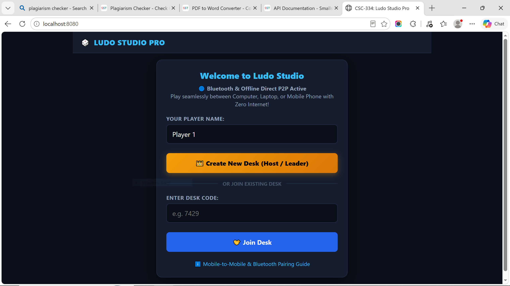
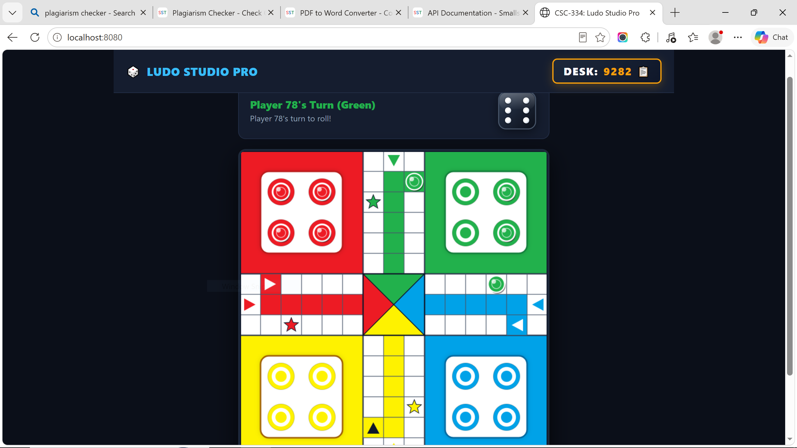
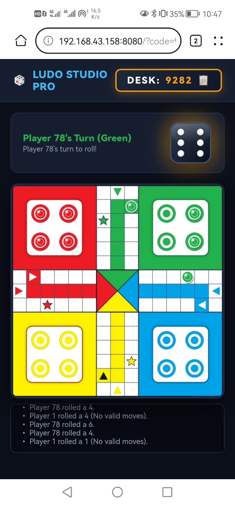

# 🎲 CSC-334: All-in-One Bluetooth Offline Ludo Multiplayer Studio (Lab 05)

<p align="center">
  
  
  
  
  
</p>

---

## 👨‍💻 Student Profile

| Field | Details |
| :--- | :--- |
| **Student Name** | **Muhammad Ahmad Mujtaba** |
| **Registration No** | **FA23-BSE-041** |
| **Class & Section** | **BSE 7A (Software Engineering)** |
| **Course Title** | **CSC-334: Parallel and Distributed Computing** |
| **Lab 05 Title** | **Distributed Multiplayer Ludo with Bluetooth Offline Networking** |

---

## 📸 System Visual Gallery & Live Traces

Here are the authentic live execution captures demonstrating cross-platform gameplay, desktop & mobile responsiveness, desk lobby management, and real scannable QR pairing:

### 1️⃣ Welcome & Desk Launcher Screen
<p align="center">
  
</p>
<p align="center">
  <i>Fig 1.1: Welcome Screen — Host can create a new desk, or joining players enter player name and a 4-digit Desk Code.</i>
</p>

---

### 2️⃣ Desk Lobby, Corner Desk Code & Scannable QR Pairing
<p align="center">
  
</p>
<p align="center">
  <i>Fig 1.2: Desk Lobby — Permanent 4-digit Desk Code in top-right header, real-time dynamic QR code for instant mobile pairing over Bluetooth / Hotspot, network interface switcher, 4 player ready-slots, and Leader-only manual start control.</i>
</p>

---

### 3️⃣ Active Match on Computer / Laptop (15x15 Vector Canvas & 3D Dice)
<p align="center">
  
</p>
<p align="center">
  <i>Fig 1.3: Desktop / Laptop In-Game View — 100% vector Canvas board reproducing exact geometry of <code>bg.jpg</code>, 3D obsidian dice button with tumbling animation, glossy tokens with golden selection halos, and live real-time turn HUD.</i>
</p>

---

### 4️⃣ Active Match on Mobile Smartphone (Responsive Touch Controls)
<p align="center">
  
</p>
<p align="center">
  <i>Fig 1.4: Mobile Smartphone View — Cross-device touch interface running seamlessly in mobile browser over Bluetooth tethering with zero installation.</i>
</p>

---

## 🌟 1. Single-File Universal Architecture (`ludo.py`)

The entire system is completely self-contained in **`Lab5(ludo with bluetooth)/ludo.py`**:
* **Zero External Dependencies**: Operates exclusively with Python's built-in standard library (`http.server`, `socket`, `threading`, `json`, `urllib`, `random`, `webbrowser`). No third-party packages or heavy frameworks are required.
* **Zero Image Asset Dependencies**: Replaces all external `.jpg` / `.png` dependencies with pure code rendering (**Canvas 2D + SVG 3D Dice + CSS**). The game will never fail due to missing image assets or path resolution errors.
* **Universal Deployment**: Runs seamlessly on Windows, macOS, Linux, and Android / iOS devices.

---

## ⚙️ 2. Detailed Technical Working & Mechanisms

```
┌────────────────────────────────────────────────────────────────────────┐
│                        CSC-334 LUDO STUDIO ARCHITECTURE                │
└────────────────────────────────────────────────────────────────────────┘
        ▲                                                ▲
        │ Local Loopback (127.0.0.1)                     │ Bluetooth PAN / Hotspot
        │                                                │ (192.168.44.x / 192.168.43.x)
┌───────┴───────────────┐                       ┌────────┴───────────────┐
│   Host Laptop / PC    │                       │   Client Smartphone    │
│  (Chrome / Edge / FF) │                       │ (Chrome / Safari Touch)│
└───────┬───────────────┘                       └────────┬───────────────┘
        │                                                │
        └───────────────────────┬────────────────────────┘
                                │ HTTP REST & State Polling (450ms)
                                ▼
         ┌──────────────────────────────────────────────┐
         │     Python Multi-Threaded HTTP Server        │
         │         (ThreadingHTTPServer :8080)          │
         ├──────────────────────────────────────────────┤
         │  • GET  /            ➔ Serves Zero-Asset UI  │
         │  • POST /api/create_desk  ➔ Unique 4-Digit   │
         │  • POST /api/join_desk    ➔ Slot Assignment  │
         │  • POST /api/start_game   ➔ Leader Validation│
         │  • POST /api/roll_dice    ➔ Engine 1-6 Roll  │
         │  • POST /api/move_token   ➔ Turn & Capture   │
         │  • GET  /api/desk_state   ➔ JSON Sync        │
         │  • GET  /api/qr_code      ➔ High-Res PNG QR  │
         ├──────────────────────────────────────────────┤
         │   Thread-Safe Desk Manager (threading.Lock)  │
         ├──────────────────────────────────────────────┤
         │     Pure Python Ludo Rules Engine Core       │
         │   (15x15 Board, 56 Steps, Captures, Kills)   │
         └──────────────────────────────────────────────┘
```

### 🧠 A. Distributed State Machine & Desk Management
1. **Thread-Safe Desk Registry**:
   - `LudoDeskManager` utilizes a reentrant mutex (`threading.Lock()`) to manage concurrent read and write operations across game desks.
   - When the host clicks **Create New Desk**, a cryptographically random 4-digit code (e.g., `2660`) is generated and locked.
2. **Permanent Corner Desk Code**:
   - The desk code is pinned to the top-right header badge (`#cornerCodeBadge`) across all views (Lobby and Active Game), allowing any player to quickly inspect and copy it.
3. **Strict Manual Start Policy (Never Auto-Starts)**:
   - To eliminate race conditions where a game begins prematurely, only the **Leader** possesses the authorization to start the match via `/api/start_game`.
   - The start button remains disabled until at least 2 players have joined and are marked as ready.
4. **State Polling & Replication**:
   - Every connected client executes a high-frequency polling routine (`450ms`) targeting `/api/desk_state?code=XXXX`.
   - The complete board state (token positions, active player turn, dice value, movable tokens, and action log) is replicated simultaneously across all screens.

---

### 🎨 B. 100% Vector Canvas Board (Exact Replica of `bg.jpg`)
Rather than loading an external static JPEG file, the game board is rendered procedurally onto an interactive 600x600 HTML5 Canvas element:
* **Authentic Quadrant Palette**: Sampled directly from authentic Ludo boards:
  * 🟥 **Red (Top-Left)**: `#ed1b24`
  * 🟩 **Green (Top-Right)**: `#22b14c`
  * 🟨 **Yellow (Bottom-Left)**: `#fef200`
  * 🟦 **Blue (Bottom-Right)**: `#00a2e8`
* **Four 6x6 Yards & Inner Cards**:
  - Each corner yard spans a 6x6 cell region with an inner 4x4 rounded card (`rx=16`, white fill, subtle drop shadow).
  - Inside each yard, 4 concentric token base discs are drawn with outer colored discs, inner white rings, and center colored dots located at exact coordinate centers `[2, 2], [4, 2], [2, 4], [4, 4]` (and respective offsets for Green, Yellow, Blue).
* **Safe Star Cells & Corridor Arrows**:
  - Exact 5-pointed vector stars are rendered in quadrant colors at safe coordinates:
    * Red Safe: `(2, 8)`
    * Green Safe: `(6, 2)`
    * Yellow Safe: `(8, 12)`
    * Blue Safe: `(12, 6)`
  - Start squares feature solid colored backgrounds with directional arrows (`▶`, `▼`, `▲`, `◀`).
  - Home corridor entrance cells feature crisp inward arrows directing tokens toward the goal.
* **Pristine Center Goal**:
  - Four triangular goal sectors meet seamlessly at `(7.5*cs, 7.5*cs)`. Track grid lines terminate at corridor boundaries so no dividing lines pierce the center goal.
* **Glossy 3D Luxury Tokens**:
  - Tokens are drawn with specular white glossy highlights, soft drop shadows, white borders, and an active gold pulsating halo when eligible to move.
  - Interactive click handlers support both precise token selection and full-yard clicking when rolling a six.

---

### 🎲 C. 3D Obsidian Vector Dice Generator (`getDiceSvg`)
Replaces external dice images (`1.jpg` to `6.jpg`) with an SVG generator:
* **Material & Geometry**: Dark obsidian rounded cube (`rx=18`) with a linear lighting gradient from `#334155` to `#0b0f19`, complemented by an upper specular bevel highlight.
* **3D Circular Pips**: Radial gradient white pips (`#ffffff` to `#cbd5e1`) with drop shadows positioned mathematically for values 1 through 6.
* **Interactive Rolling Physics**:
  - When rolled, a CSS rotation keyframe spins the dice 360 degrees while an interval rapidly cycles face values (1 to 6) at 60ms intervals before locking onto the server-validated dice outcome.
  - A gold glow pulse indicates when it is the local player's turn to roll.

---

### 📶 D. Zero-Internet Bluetooth & Hotspot Connectivity
1. **Method 1: Offline Mobile Hotspot (Fastest & Universal)**:
   - Turn ON Mobile Hotspot on the host laptop or phone (keep Mobile Data OFF).
   - Other phones or laptops connect to this Wi-Fi hotspot.
   - Scan the on-screen QR Code or open `http://<Host-IP>:8080` in any browser.
2. **Method 2: Pure Bluetooth Tethering (Zero Wi-Fi Required)**:
   - Pair devices via Bluetooth.
   - Host turns ON **Bluetooth Tethering** in phone settings.
   - Client joins the Bluetooth PAN network.
   - Open the Bluetooth IP shown on the screen or scan the QR Code.

---

## 📜 3. Authentic Ludo Game Rules Implementation

The game engine strictly enforces official competitive Ludo rules:
* **Track Length**: 52 common outer track squares + 5 colored home corridor squares = 56 steps to reach Goal (position `56`).
* **Exit Yard Rule**: A player **must roll a 6** to release a token from the yard (`pos = -1`) onto their colored start square (`pos = 0`).
* **Three Sixes Penalty**: Rolling three consecutive sixes forfeits the player's turn immediately, resetting the dice to zero and advancing play to the next contestant.
* **Blockade Mechanics**: Two or more tokens of the same player on a single square form an impassable barrier that opponent tokens cannot jump or capture.
* **Token Captures & Bonus Turns**: Landing on an opponent's lone token captures it, returning it to their home yard and granting the attacking player an immediate bonus turn.
* **Bonus Turns on Six & Goal**: Rolling a 6 or reaching the home goal grants an additional dice roll.
* **Victory Condition**: The first player to successfully move all 4 tokens into the central home goal wins the match.

---

## 🚀 4. How to Run & Play

### Step 1: Clone Repository
```bash
git clone https://github.com/FA23-BSE-041-A-MUHAMMADAHMADMUJTABA/Parallel-and-Distributed-Computing.git
cd "Parallel-and-Distributed-Computing/Lab5(ludo with bluetooth)"
```

### Step 2: Start Game Studio
```bash
python ludo.py
```
*(Or double-click `run_ludo.bat` on Windows)*

### Step 3: Open in Browser
* **On Host Machine**: Automatically opens `http://localhost:8080`.
* **On Other Devices**: Scan the on-screen QR Code or visit `http://<Local-IP>:8080`.

---

<p align="center">
  <i>Developed for CSC-334: Parallel and Distributed Computing • Department of Computer Science & Software Engineering</i>
</p>
